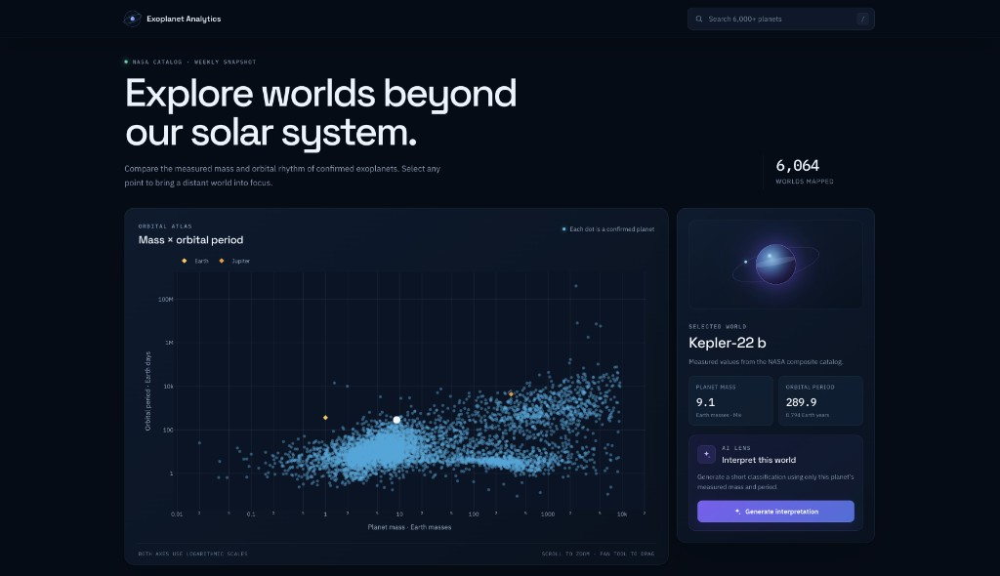

# Exoplanet Analytics

Explore how the masses and orbital periods of confirmed exoplanets relate in an
interactive, searchable dashboard powered by the NASA Exoplanet Archive.

**[Open the live dashboard →](https://exoplanet-analytics.vercel.app/)**

> The API is hosted on Render's free tier, so the first load can take a moment
> while a sleeping instance wakes up.



## What you can do

- Explore 6,000+ confirmed planets on a log–log mass-versus-period chart.
- Hover over any point to identify a planet; use Zoom or Pan when the field is dense.
- Click a point or search by name to inspect its mass and orbital period.
- Generate a concise AI interpretation based only on those two measured values.
- Work from a catalog refreshed automatically from NASA each week.

AI interpretations are speculative, educational summaries—not scientific
assessments. They do not infer temperature, atmosphere, climate, host-star
properties, or habitability.

## How it works

```text
NASA Exoplanet Archive
          │
          │ weekly TAP query
          ▼
refresh_planets.py ── clean and deduplicate ──► api/planets.json
                                                       │
React + Plotly ◄──────── GET /planets ─────────── FastAPI
      │                                                │
      └─────────────── POST /analyze ──────────────────┤
                                                       ▼
                                              OpenAI GPT-4o mini
```

The chart reads a checked-in JSON snapshot rather than querying NASA during a
request. This keeps exploration fast and available even when the upstream
archive is slow. The OpenAI key stays in the API; it is never exposed to the
browser.

### Stack

| Layer | Technology |
| --- | --- |
| Frontend | React 19, Vite, Plotly.js |
| API | FastAPI, pandas |
| AI | OpenAI GPT-4o mini |
| Data pipeline | NASA TAP API, requests, pandas, GitHub Actions |
| Hosting | Vercel frontend, Render API |

## Run locally

### Prerequisites

- Python 3.13
- Node.js 22
- An OpenAI API key if you want to use AI analysis

### 1. Start the API

From the repository root:

```bash
python3.13 -m venv .venv
source .venv/bin/activate
pip install -r api/requirements.txt
cp api/.env.example api/.env
uvicorn api.main:app --reload --reload-dir api --port 8000
```

The catalog and interactive API docs are then available at:

- `http://localhost:8000/planets`
- `http://localhost:8000/docs`

The chart works without an OpenAI key. To enable **Generate interpretation**, set
`OPENAI_API_KEY` in `api/.env`.

### 2. Start the frontend

In a second terminal:

```bash
cd frontend
npm ci
npm run dev
```

Open [http://localhost:5173](http://localhost:5173). In local development, Vite
proxies `/planets` and `/analyze` to the API, so `VITE_API_URL` can stay unset.

## Configuration

| Variable | Used by | Default | Purpose |
| --- | --- | --- | --- |
| `OPENAI_API_KEY` | API | unset | Enables the `/analyze` endpoint |
| `CORS_ORIGINS` | API | local Vite origins | Comma-separated browser origins allowed to call the API |
| `VITE_API_URL` | Frontend | unset in local dev (Vite proxy) | Public FastAPI origin, embedded when Vite builds |

Copy the included examples when you need to override a default:

```bash
cp api/.env.example api/.env
cp frontend/.env.example frontend/.env
```

Never put `OPENAI_API_KEY` in the frontend environment. Variables prefixed with
`VITE_` are shipped to the browser.

## API

### `GET /planets`

Returns the cleaned catalog:

```json
[
  {
    "pl_name": "11 Com b",
    "pl_bmasse": 4914.89849,
    "pl_orbper": 323.21
  }
]
```

### `POST /analyze`

```json
{
  "selectedPlanet": "11 Com b"
}
```

Returns a two-sentence mass and orbit interpretation. Requests are limited to
15 per IP address per rolling hour. The current limiter is in memory and is
intended to protect this small public deployment, not to provide distributed
rate limiting.

## Data

The refresh script queries the
[Planetary Systems Composite Parameters (`pscomppars`)](https://exoplanetarchive.ipac.caltech.edu/docs/API_PSCompPars_columns.html)
table:

```sql
SELECT pl_name, pl_bmasse, pl_orbper
FROM pscomppars
```

- `pl_name`: planet name
- `pl_bmasse`: planetary mass or mass × sin(i), in Earth masses
- `pl_orbper`: orbital period, in days

`pscomppars` provides one composite row per planet and chooses the best
available reference independently for each field. A planet's mass and period
can therefore come from different publications.

To refresh the snapshot manually:

```bash
source .venv/bin/activate
python scripts/refresh_planets.py
```

The script removes records without a mass or period, deduplicates by planet
name, and writes `api/planets.json`. The
[scheduled workflow](.github/workflows/refresh-planets.yml) runs the same
process every Monday at 16:00 UTC and commits changes when NASA's catalog has
updated.

## Project structure

```text
api/
├── main.py                 # FastAPI routes, catalog cache, and OpenAI call
├── planets.json            # generated catalog snapshot
└── requirements.txt
frontend/
├── src/                    # React dashboard and styles
└── package.json
docs/
└── exoplanet-analytics-desktop.jpg
scripts/
└── refresh_planets.py      # NASA catalog ingestion
.github/workflows/
└── refresh-planets.yml     # weekly catalog refresh
```

## Production deployment

The deployed frontend expects these values:

| Service | Variable | Value |
| --- | --- | --- |
| Render | `OPENAI_API_KEY` | Your server-side secret |
| Render | `CORS_ORIGINS` | `https://exoplanet-analytics.vercel.app` |
| Vercel | `VITE_API_URL` | `https://exoplanet-api-rpsl.onrender.com` |

Set `VITE_API_URL` before building the frontend because Vite embeds it at build
time.

## Data credit

Catalog data comes from the
[NASA Exoplanet Archive](https://exoplanetarchive.ipac.caltech.edu/), operated
by the California Institute of Technology under contract with NASA.
